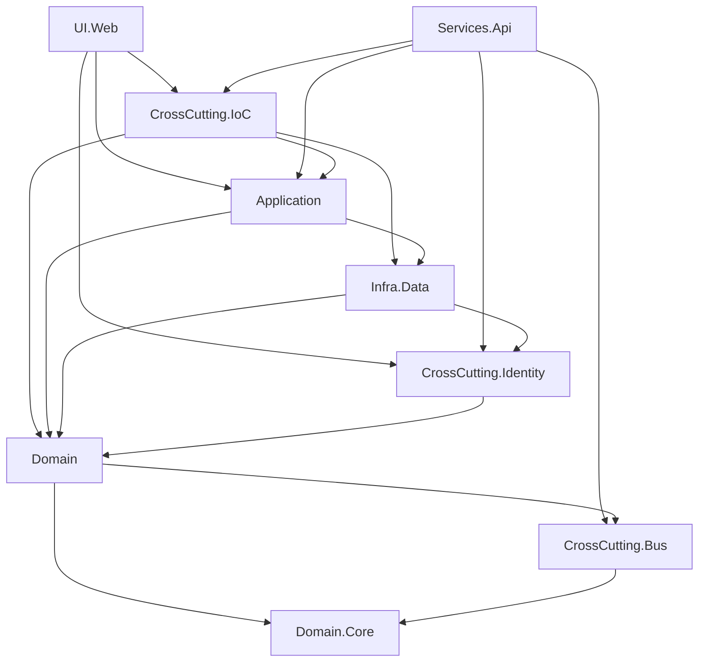

# Arquitetura do Equinox — guia para quem chega hoje

> Toda afirmação sobre dependência ou ponto de entrada cita o arquivo que a comprova (caminhos relativos à raiz do repositório). Conferido no código em 27/11/2026.

## 1. Projetos da solution

Pastas e aninhamento definidos em `Equinox.sln` (seção `NestedProjects`). Todos os projetos estão em `net9.0` (`<TargetFramework>` de cada `.csproj`).

| Camada (pasta na .sln) | Projeto | O que faz |
|---|---|---|
| 1 - Presentation | `Equinox.UI.Web` | Site MVC + Razor Pages (Identity UI), telas de clientes. |
| 2 - Services | `Equinox.Services.Api` | API REST de clientes + login/registro com JWT, Swagger. |
| 3 - Application | `Equinox.Application` | App services e ViewModels; traduz ViewModel em Command e envia ao bus. |
| 4 - Domain | `Equinox.Domain` | Entidade `Customer`, Commands, validações (FluentValidation), handlers, eventos. |
| 4 - Domain | `Equinox.Domain.Core` | Base do domínio (`StoredEvent`, `IEventStore`); se apoia no pacote NetDevPack. |
| 5.1 - Data | `Equinox.Infra.Data` | EF Core: `EquinoxContext` (Unit of Work), `EventStoreSqlContext`, repositórios, migrations. |
| 5.2 - CrossCutting | `Equinox.Infra.CrossCutting.Bus` | `InMemoryBus`: envia commands e publica eventos (gravando-os no event store). |
| 5.2 - CrossCutting | `Equinox.Infra.CrossCutting.Identity` | ASP.NET Identity, JWT, autorização por claim, `EquinoxIdentityContext`. |
| 5.2 - CrossCutting | `Equinox.Infra.CrossCutting.IoC` | `NativeInjectorBootStrapper`: registra tudo no DI nativo. |
| 6 - Tests | `Equinox.Tests.Architecture` | Testes de arquitetura com NetArchTest (xUnit). |

## 2. Quem depende de quem

Arestas = `<ProjectReference>` de cada `src/*/*.csproj` (o projeto de testes, que referencia todos, foi omitido).

Pontos que surpreendem: o Domain referencia o Bus (`src/Equinox.Domain/Equinox.Domain.csproj:8`); o Infra.Data referencia o Identity (`src/Equinox.Infra.Data/Equinox.Infra.Data.csproj:8`), porque o `SqlEventStore` usa `IAspNetUser` para registrar quem gerou o evento (`src/Equinox.Infra.Data/EventSourcing/SqlEventStore.cs:14`); e o Application referencia o Infra.Data diretamente (`src/Equinox.Application/Equinox.Application.csproj:8`).

## 3. Pontos de entrada

| | Site (`Equinox.UI.Web`) | API (`Equinox.Services.Api`) |
|---|---|---|
| Entrada | `src/Equinox.UI.Web/Program.cs` | `src/Equinox.Services.Api/Program.cs` |
| Configura | MVC → Banco → Identity Web → DI (`Program.cs:7-10`) | Controllers → Banco → Identity API + JWT → Swagger → DI (`Program.cs:8-12`) |
| Pipeline | HTTPS, static files, routing, authN/authZ, rota MVC padrão `Home/Index` + Razor Pages (`Program.cs:27-34`) | HTTPS, CORS liberado para qualquer origem, authN/authZ, controllers + `MapIdentityApi<IdentityUser>` + Swagger (`Program.cs:17-30`) |
| Ao subir | `UseDbSeed()` aplica migrations e cria usuário/cliente de exemplo, só em `Development` ou `Docker` (`Program.cs:37`, `Configurations/DbMigrationHelpers.cs:30-36`) | Não aplica migrations. |
| Portas (`Properties/launchSettings.json`) | Self Hosted: https 61666 / http 61093; IIS Express: 10262 / ssl 44314 | Self Hosted: https 5001 / http 5000 (abre em `/swagger`); IIS Express: 59223 / ssl 44389 |
| Docker | `src/Equinox.UI.Web/Dockerfile` (`EXPOSE 80/443`) | `src/Equinox.Services.Api/Dockerfile` (`EXPOSE 80/443`) |

Ambos registram as dependências pelo mesmo `NativeInjectorBootStrapper.RegisterServices` (`src/Equinox.Infra.CrossCutting.IoC/NativeInjectorBootStrapper.cs:23`), chamado em `Configurations/DependencyInjectionConfig.cs` de cada projeto.

## 4. Fluxo do site: cadastro de um cliente até o banco

1. `POST /customer-management/register-new` → `CustomerController.Create`, protegido por `[CustomAuthorize("Customers","Write")]` (`src/Equinox.UI.Web/Controllers/CustomerController.cs:41-52`). Antiforgery é global (`src/Equinox.UI.Web/Configurations/MvcConfig.cs:19`).
2. `CustomerAppService.Register` converte o ViewModel em `RegisterNewCustomerCommand` e chama `_mediator.SendCommand` (`src/Equinox.Application/Services/CustomerAppService.cs:34-37`).
3. `InMemoryBus.SendCommand` repassa ao mediator do NetDevPack (`src/Equinox.Infra.CrossCutting.Bus/InMemoryBus.cs:23-26`), que resolve o handler registrado no IoC (`NativeInjectorBootStrapper.cs:38`).
4. `CustomerCommandHandler.Handle`: valida o command (FluentValidation, `src/Equinox.Domain/Commands/Validations/CustomerValidation.cs`), rejeita e-mail repetido, cria o `Customer`, anexa `CustomerRegisteredEvent`, chama `_customerRepository.Add` e `Commit` (`src/Equinox.Domain/Commands/CustomerCommandHandler.cs:20-36`).
5. `EquinoxContext.Commit` publica os eventos de domínio **antes** do `SaveChangesAsync` (`src/Equinox.Infra.Data/Context/EquinoxContext.cs:41-53`).
6. Cada evento passa por `InMemoryBus.PublishEvent` → `SqlEventStore.Save` → `EventStoreSqlRepository.Store`, que grava na tabela `StoredEvent` com `SaveChanges` próprio (`InMemoryBus.cs:15-21`, `src/Equinox.Infra.Data/EventSourcing/SqlEventStore.cs:20-37`, `src/Equinox.Infra.Data/Repository/EventSourcing/EventStoreSQLRepository.cs:25-28`). O `CustomerEventHandler` só retorna `Task.CompletedTask` (`src/Equinox.Domain/Events/CustomerEventHandler.cs`).
7. O cliente é salvo na tabela de `Customers` (`EquinoxContext.cs:25,53`). Erros voltam como `ValidationResult` e viram erros de `ModelState` (`src/Equinox.UI.Web/Controllers/BaseController.cs:10-17`).

Banco: em `Development` é SQLite `EquinoxProject.db` (`src/Equinox.UI.Web/Configurations/DatabaseConfig.cs:12-19`, `appsettings.Development.json`); nos demais ambientes, SQL Server LocalDB (`DatabaseConfig.cs:24-28`, `appsettings.Staging.json`). Os três contextos (`EquinoxContext`, `EventStoreSqlContext`, `EquinoxIdentityContext`) usam a mesma `DefaultConnection`.

## 5. Fluxo da API: requisição até o banco, com autenticação

1. **Obter token**: `POST /account/new` (registra) ou `POST /account/enter` (login) em `src/Equinox.Services.Api/Controllers/AccountController.cs:27-77`. O `JwtBuilder` monta o JWT com as claims do usuário e suas roles (`src/Equinox.Infra.CrossCutting.Identity/API/JwtBuilder.cs:54-70`), válido por `AppSettings:Expiration` horas (`JwtBuilder.cs:84`; valor 2 em `src/Equinox.Services.Api/appsettings.Development.json`).
2. **Validar token**: `AddJwtSupport` configura JwtBearer com chave simétrica, issuer e audience lidos de `AppSettings` (`src/Equinox.Infra.CrossCutting.Identity/Configuration/AspNetIdentityConfig.cs:79-101`). O Swagger aceita `Authorization: Bearer {token}` (`src/Equinox.Services.Api/Configurations/SwaggerConfig.cs:24-32`).
3. **Autorizar**: `CustomerController` tem `[Authorize]` na classe; GETs são `[AllowAnonymous]`; POST/PUT exigem claim `Customers` contendo `Write` e DELETE contendo `Remove` (`src/Equinox.Services.Api/Controllers/CustomerController.cs:10-53`). O filtro devolve 401 sem login e 403 sem a claim (`src/Equinox.Infra.CrossCutting.Identity/Authorization/RequerimentClaimFilter.cs:16-28`).
4. **Até o banco**: `POST /customer` → `_customerAppService.Register` → mesmo caminho dos passos 2–7 do site. Resposta: 200 ou 400 com `ValidationProblemDetails` (`src/Equinox.Services.Api/Controllers/ApiController.cs:12-23`).

Banco da API: `EquinoxContext` e `EventStoreSqlContext` **sempre** SQL Server (`src/Equinox.Services.Api/Configurations/DatabaseConfig.cs:12-16`); o `appsettings.Development.json` da API aponta para LocalDB.

## 6. Identity

- **Configuração**: `src/Equinox.Infra.CrossCutting.Identity/Configuration/AspNetIdentityConfig.cs`. O site usa `AddWebIdentityConfiguration` (Identity com cookies + Default UI + login Facebook/Google, linhas 30-38, 69-77, 114-131); a API usa `AddApiIdentityConfiguration` (Identity API endpoints + roles + JWT, linhas 20-28, 57-67, 79-104).
- **Onde ficam os usuários**: `EquinoxIdentityContext : IdentityDbContext` (`src/Equinox.Infra.CrossCutting.Identity/Data/EquinoxIdentityContext.cs:10`), tabelas padrão do Identity (`AspNetUsers`, `AspNetUserClaims`, `AspNetRoles`…) no mesmo banco da `DefaultConnection`. Migrations em `src/Equinox.Infra.CrossCutting.Identity/Migrations/`.
- **Permissões**: são **claims de usuário**, não roles. Ex.: claim `Customers` = `Write,Remove`, lida separando por vírgula (`src/Equinox.Infra.CrossCutting.Identity/Authorization/CustomAuthorizationValidation.cs:8-14`). O seed cria `teste@teste.com` com essa claim (`src/Equinox.UI.Web/Configurations/DbMigrationHelpers.cs:49-70`).
- **Usuário atual**: `IAspNetUser`/`AspNetUser` (`src/Equinox.Infra.CrossCutting.Identity/User/`), registrado em `AddAspNetUserSupport` (`AspNetIdentityConfig.cs:106-112`).

## 7. O que eu ainda não sei (não consegui confirmar no código)

- **.NET 10 x .NET 9**: `AGENTS.md` manda instalar o SDK 10.0, mas todos os `.csproj` estão em `net9.0`, os pacotes são 9.0.x e o CI usa `dotnet-version: 9.0.x` (`.github/workflows/dotnet-core.yml:19`). O commit `51da450` diz explicitamente que mudou "só textos". Não sei se o SDK 10 compila sem ajustes (não rodei o build).
- **Dockerfiles desatualizados**: usam imagens `aspnet:6.0`/`sdk:6.0` (`src/*/Dockerfile:3,8`) para projetos `net9.0`; provavelmente não sobem. Não há `docker-compose` no repositório.
- **API em Development**: o `EquinoxIdentityContext` usa SQLite em Development (`AspNetIdentityConfig.cs:42-46`), mas a connection string da API é de SQL Server LocalDB. Parece que a API em Development quebra ao acessar o Identity; não executei para confirmar.
- **Duas formas de login na API**: além de `/account/enter` (JWT próprio), `MapIdentityApi<IdentityUser>()` (`Program.cs:28`) expõe `/login`, `/register` etc., escondidos do Swagger (`SwaggerConfig.cs:50-77`). Não sei se o token desses endpoints é aceito pelo esquema JwtBearer configurado; qual é o caminho "oficial" não está documentado.
- **Teste de arquitetura x .csproj**: `DomainTests` afirma que o Domain não depende de `Equinox.Domain.Core` nem de `Equinox.Infra.CrossCutting.Bus` (`tests/Equinox.Tests.Architecture/DomainTests.cs:17-27`), mas o `.csproj` do Domain referencia os dois. O NetArchTest olha tipos usados, não referências; não rodei os testes para saber se passam.
- **Migrations fora de Development**: o seed/migração só roda com `ASPNETCORE_ENVIRONMENT` = `Development` ou `Docker` (`DbMigrationHelpers.cs:30`), mas nenhum arquivo define o ambiente `Docker` (o perfil "Docker" de `src/Equinox.UI.Web/Properties/launchSettings.json` não define essa variável). Não encontrei como o banco é criado em Staging/Production; há uma pasta `sql/` na raiz que não investiguei.
- **Portas no container**: os Dockerfiles expõem 80/443, mas não definem `ASPNETCORE_URLS`; se as imagens forem atualizadas para .NET 8+, a porta padrão passa a ser 8080. Não verifiquei como os containers são publicados.
